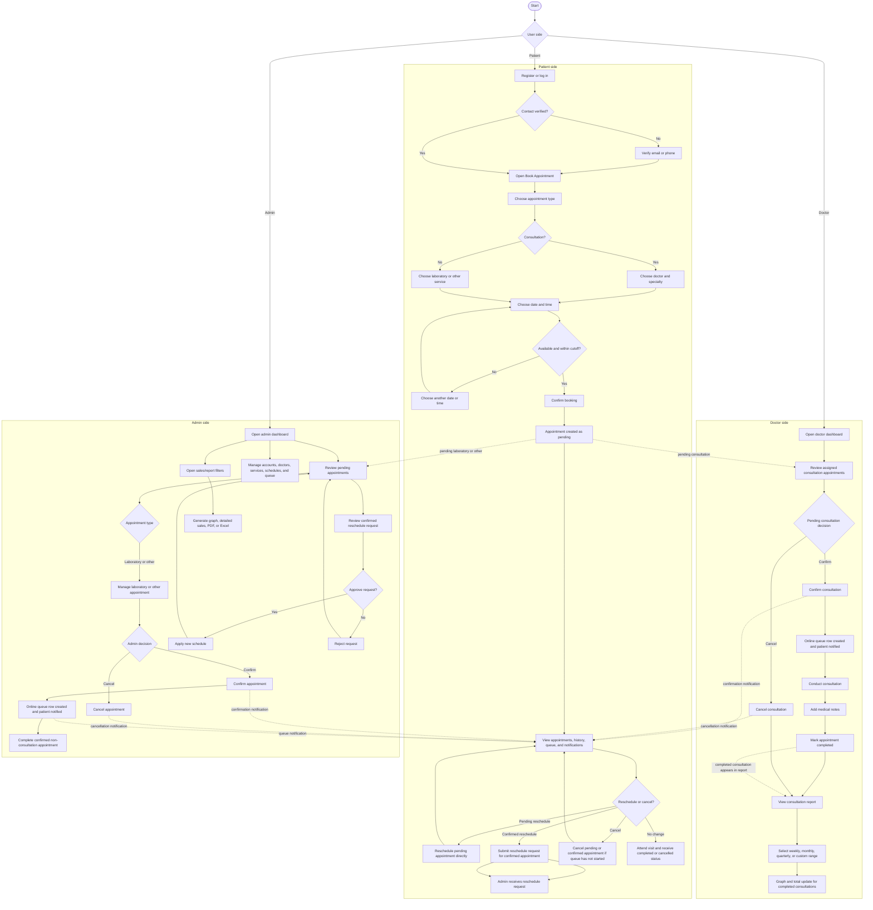
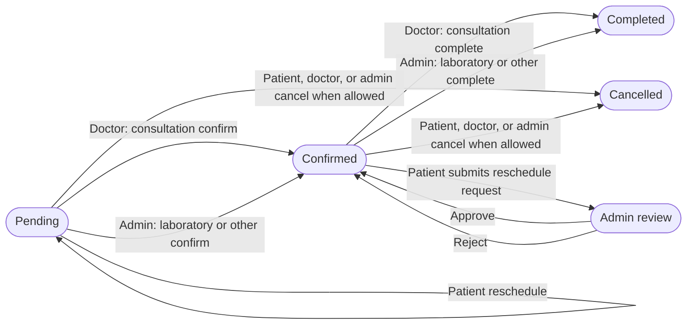
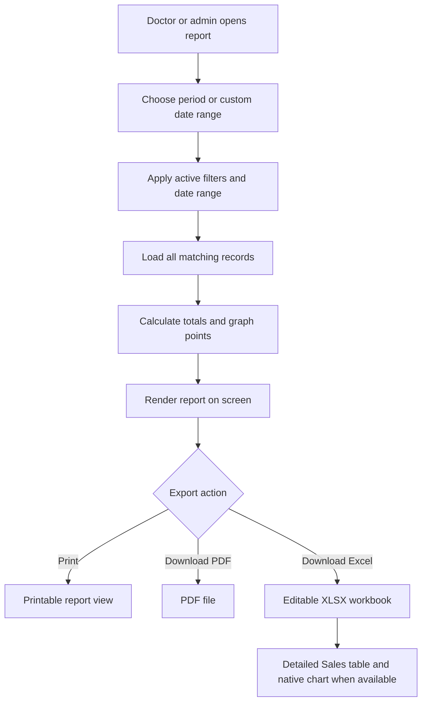

# Globalife System Flowchart

This flowchart documents the current patient, doctor, and admin workflow implemented in the system.

## End-to-End Workflow

## Appointment Status Flow

## Report and Export Flow

## Rules Captured

- New bookings start as `pending`.
- Doctors control the confirmation, cancellation, and completion of their own consultation appointments.
- Admin controls laboratory and other appointment workflows, account/master-data management, queue management, and reports.
- A pending patient reschedule remains pending and can be changed directly.
- A confirmed patient reschedule becomes a request for admin review.
- Completed consultations feed the doctor's consultation report.
- Patient, doctor, and admin views use their own permitted records and actions.
